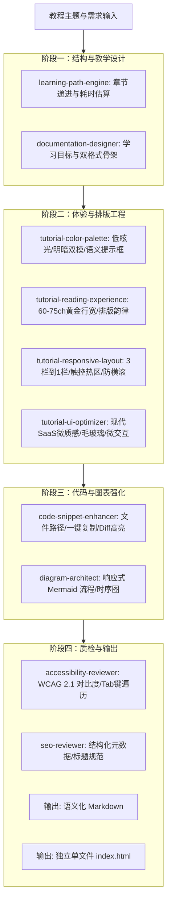

# 基于 Agentic Engineering 体系构建现代高质量技术教程实战指南

> **适用场景**：本文档面向教程作者、开发者、技术文档工程师及 AI 协同创作者，系统性阐述如何调动与编排工作区内的 `AGENTS.md`、专业 Skills、设计规范及模板资产，自动化、高品质地生成具备现代 SaaS 质感、极致阅读体验与多端自适应能力的教程文件（Markdown 与独立单文件 `index.html`）。

---

## ⏱️ 概览与前置导读

- **预计阅读耗时**：10 分钟
- **难度级别**：中级（面向工程化协作与提示工程实践）
- **核心依赖文件**：
  - [AGENTS.md](AGENTS.md)：全流程代理编排规则与 Skill 清单
  - [docs/design-system.md](docs/design-system.md)：现代设计系统规范与视觉 Token
  - [docs/documentation-rubric.md](docs/documentation-rubric.md)：0-100 评分准则与质检验收表
  - [templates/html/tutorial-template.html](templates/html/tutorial-template.html)：独立可运行的单文件 HTML 模板

---

## 🎯 核心学习目标

完成本篇指南的学习后，你将能够：
1. **全面掌握体系架构**：理解 13 个专业 Skill 在教程创作全生命周期中的分工与流水线协作逻辑。
2. **掌握三维体验优化法则**：学会运用配色调色板、黄金阅读行宽和响应式重排，避免常见排版与移动端溢出问题。
3. **熟练运用四步动作节拍**：编写符合认知心理学、具备自愈校验与渐进披露特性的高质量教程正文。
4. **一键生成双格式产物**：输出标准兼容的 GitHub 风格 Markdown 文档与具备暗黑切换、阅读进度条、代码复制的独立 `index.html`。

---

## 🗺️ 架构拓扑：Agentic Engineering 协同流水线

在创建教程时，AI Agent 并非随机发挥，而是依据以下四个标准化阶段严格流转与执行：



---

## 1. 核心 Skills 职责与选型速查表

在编写教程提示词（Prompt）或拆解任务时，可按需精准调用对应领域的 Skill：

| 分类领域 | 对应 Skill 路径 | 核心能力与关键规则 |
| :--- | :--- | :--- |
| **教学架构** | [skills/learning-path-engine/SKILL.md](skills/learning-path-engine/SKILL.md) | 梳理前置知识体系、设定时间消耗指标、设计认知负荷阶梯 |
| **文档总控** | [skills/documentation-designer/SKILL.md](skills/documentation-designer/SKILL.md) | 强制“四步动作节拍”、双制品交付（Markdown + 独立 HTML）架构 |
| **色彩质感** | [skills/tutorial-color-palette/SKILL.md](skills/tutorial-color-palette/SKILL.md) | 浅色 `#F8FAFC`、深色 `#0B0F19`；四类语义提示框规范；WCAG 对比度保障 |
| **阅读体验** | [skills/tutorial-reading-experience/SKILL.md](skills/tutorial-reading-experience/SKILL.md) | 锁定 `60ch–72ch` 黄金阅读行宽；Leading 1.75–1.8；吸顶目录防遮挡偏移 |
| **多端布局** | [skills/tutorial-responsive-layout/SKILL.md](skills/tutorial-responsive-layout/SKILL.md) | 桌面三栏 $\rightarrow$ 移动端单栏；代码容器横滚防溢出；移动端底部悬浮触控条 |
| **UI 细节** | [skills/tutorial-ui-optimizer/SKILL.md](skills/tutorial-ui-optimizer/SKILL.md) | Linear / Stripe 风格的 1px 微边框、毛玻璃导航、微交互动画 |
| **代码增强** | [skills/code-snippet-enhancer/SKILL.md](skills/code-snippet-enhancer/SKILL.md) | 顶部文件路径标签、1键复制带反馈动画、Diff 代码差异着色 |
| **架构图表** | [skills/diagram-architect/SKILL.md](skills/diagram-architect/SKILL.md) | 聚焦型 Mermaid 图表（单图 $\le 8$ 节点）、明暗自动反色、矢量缩放 |
| **合规质检** | [skills/accessibility-reviewer/SKILL.md](skills/accessibility-reviewer/SKILL.md) | WCAG 2.1 AA/AAA 校验、无障碍 Tab 导航检查、触控热区 $\ge 44\text{px}$ 验证 |

---

## 2. 创作规范：四步动作节奏与认知减负

优质技术教程必须具备极强的**易学性**与**自愈验证机制**。本体系要求所有正文步骤严格遵循 **四步动作节拍法**：

### 2.1 步骤结构剖析

```markdown
### 步骤 N：动词引导的操作目标 (Actionable Heading)
1. 前置说明与技术原理（1–2 句话清晰交代“为什么做”，严禁大段空泛理论）
2. 具体执行代码 / 配置块（必须标注文件名与语言，突出变更行）
3. 终端运行与预期结果（提供直观输出与成功标记，供读者校验）
4. 进阶原理或边缘陷阱（使用折叠卡片封装，防止干扰主线进度）
```

### 2.2 示例演示：标准的四步节拍写法

> **实战示例：配置数据契约**

#### 步骤 1：定义环境变量与运行时校验契约
在生产级微服务中，启动阶段即拦截非法配置是避免运行时崩溃的最佳实践。我们使用 Zod 建立强类型约束。

```typescript title="src/config/env.ts"
import { z } from 'zod';

export const EnvSchema = z.object({
  PORT: z.coerce.number().default(3000),
  DATABASE_URL: z.string().url('必须提供合法的数据库连接 URI'),
  ENABLE_METRICS: z.boolean().default(true),
});

export type AppConfig = z.infer<typeof EnvSchema>;
```

**运行验证与预期终端回显**：
执行校验测试，终端应显示绿色的通过指示：

```bash
$ pnpm test:config
✔ [Config] Schema validated successfully.
✔ [Config] Active profile: development (Port: 3000)
✨ Done in 0.84s.
```

> [!WARNING]
> 容器化部署时切勿将 `DATABASE_URL` 写死为 `localhost`，应使用服务发现名称（如 `postgres:5432`）。

<details>
<summary>🔍 深入剖析：为什么使用 <code>z.coerce</code> 而不是 <code>z.number()</code>？</summary>
<div style="margin-top: 0.5rem;">
操作系统注入的环境变量本质均为字符串类型。使用 <code>z.coerce.number()</code> 可以在解析阶段自动完成类型安全转换，规避常见的运行时 NaN 异常。
</div>
</details>

---

## 3. 双制品生成与落地指引

根据 [skills/documentation-designer/SKILL.md](skills/documentation-designer/SKILL.md) 规定，每一次教程生成都应同步具备两种交付物形态：

### 3.1 制品一：语义化 Markdown (`.md`)
- **适用媒介**：Git 仓库协同、GitHub Release、VitePress / Docusaurus 静态站点生成。
- **排版要素**：
  - 标准 GitHub Admonition 语法（`> [!NOTE]`、`> [!TIP]`、`> [!WARNING]`、`> [!CAUTION]`）。
  - 代码块携带文件名属性：````ts title="path/to/file.ts"````。
  - 标准 `mermaid` 代码块声明。

### 3.2 制品二：独立单文件 HTML (`index.html`)
- **适用媒介**：离线分发、单网页教学演示、产品内置帮助页面（双击浏览器即开即看，零 Node.js / 打包器环境要求）。
- **技术实现标准**（基于 [templates/html/tutorial-template.html](templates/html/tutorial-template.html)）：
  - **色彩方案**：内嵌 `:root` 与 `[data-theme="dark"]` CSS 变量，支持右上角一键切换，偏好记忆至 `localStorage`。
  - **阅读行宽**：正文使用 `.prose-container` 严格锁定在 `72ch` 以内。
  - **动态阅读进度**：顶部渐变进度条实时监听滚动计算百分比。
  - **吸顶 Scrollspy 目录**：右侧 TOC 自动监听标题区域视口交叉（`IntersectionObserver`）并实时高亮对应小节。
  - **代码一键复制**：每个代码块均有点击复制按钮，复制成功后有轻量提示动画。
  - **多屏自适应**：移动端自动切换为底部悬浮操作栏（上一节 / 进度 / 下一节），代码块与表格在内部横滚，杜绝页面横向滚动条。

---

## 4. 实战指令（Prompt）模板库

在 Copilot 或各类 LLM 编程助手中，你可以直接复用以下结构化 Prompt，以充分激活本套 Agentic Engineering 规则：

### 4.1 全流程教程生成 Prompt

```markdown
请调用当前工作区的 Agentic Engineering 体系（遵循 AGENTS.md、docs/design-system.md 以及相关 Skills），为我生成关于【输入主题，例如：Rust 与 WebAssembly 零基础实战】的技术教程。

要求严格对齐以下标准：
1. 教学设计：依据 learning-path-engine 和 documentation-designer，开篇列出预计耗时、前置条件与核心学习目标；正文采用“四步动作节拍法”，次要技术细节使用可折叠卡片封装。
2. 视觉与体验：依据 tutorial-color-palette 和 tutorial-reading-experience，配置现代低眩光明暗双模配色（浅色 #F8FAFC / 深色 #0B0F19），正文阅读宽度限制在 60-75ch，标题预留滚动偏移。
3. 交互与多端：依据 code-snippet-enhancer、diagram-architect 和 tutorial-responsive-layout，代码块标注文件路径与一键复制功能；内嵌 1 个 Mermaid 架构图；移动端具备防溢出横滚与底部悬浮导航。
4. 双格式输出：
   - 先输出规范的 Markdown 文件内容；
   - 随后输出完全独立的、基于 templates/html/tutorial-template.html 结构的 index.html 代码。
```

### 4.2 现有教程优化与翻新 Prompt

```markdown
请充当 tutorial-ui-optimizer、accessibility-reviewer 和 tutorial-reading-experience 专家，对我提供的这篇旧教程进行审查与重构：

优化重点：
1. 检查并修正未对齐的阅读行宽与段落垂直韵律；
2. 为原本零散的代码块补齐文件名标识、预期终端输出回显与一键复制结构；
3. 将杂乱的提示信息重构为符合 WCAG 2.1 双重编码规范的语义提示框；
4. 输出重构后的 Markdown 以及适配现代样式的独立单文件 index.html。
```

---

## 5. 质量评估与验收清单 (0–100 Rubric)

在教程生成完毕后，可依照 [docs/documentation-rubric.md](docs/documentation-rubric.md) 进行打分复核：

- [ ] **视觉设计与调色板（20分）**：采用低眩光米白与深黑曜石色调，文字对比度 $\ge 4.5:1$，代码块高亮与页面主题融合。
- [ ] **阅读体验与行宽（20分）**：正文限制在 `60ch–72ch`，行高 $1.75\sim 1.8$，标题设置了 `scroll-margin-top` 防止遮挡。
- [ ] **教学节奏与四步法（20分）**：具备开篇目标清单与预计时间，正文按“动作 $\rightarrow$ 原理 $\rightarrow$ 代码 $\rightarrow$ 验证”推进。
- [ ] **多屏幕响应式适配（20分）**：桌面三栏到移动端单栏，代码和表格横滚不破视口，移动端触控热区 $\ge 44\text{px}$。
- [ ] **技术准确与双产物（20分）**：同时交付标准 Markdown 与独立单文件 `index.html`，代码无语法错误，HTML 可开箱即用。

---

## 💡 总结与建议

通过将知识固化为 **Skills、设计系统（Design System）与代码模板（Templates）**，Agentic Engineering 能够让 AI 稳定产出超越普通 Markdown 的**工业级交互式技术教程**。持续维护这些资产，并根据读者反馈微调色彩与字阶，将持续保持教程的高水准交付。
